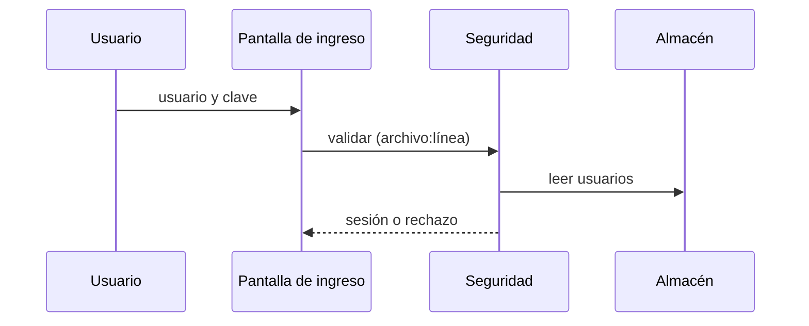
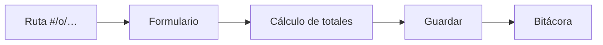

# Mapa del sistema

> Sistema: _(nombre)_ · Foto: huella `_(12 primeros caracteres)_`
> Todo con `archivo:línea`; lo no verificado, **por verificar**.

## 1. Qué es

_(2 o 3 líneas: rubro, para quién, qué problema resuelve. Tomado de `js/config.js` y de lo que ves al abrirlo.)_

## 2. Capas y módulos

| Capa | Archivo | Responsabilidad | Depende de |
|---|---|---|---|
| Utilidades | `js/00-util.js` | | |
| Persistencia | | | |
| Seguridad | | | |
| Auditoría | | | |
| Datos (CRUD) | | | |
| Cálculos | | | |
| Interfaz | | | |
| Reportes | | | |
| Arranque y rutas | | | |
| Configuración | `js/config.js` | | |

Orden de carga (de `index.html`): _(pega la lista de la foto)_

## 3. Flujos principales

### 3.1 Ingreso y sesión

_(Corrige el diagrama con lo que realmente hace el código y cita las líneas.)_

### 3.2 _(Flujo del negocio, p. ej. emitir una venta)_

_(Qué función hace cada paso: `archivo:línea`.)_

### 3.3 _(Otro flujo: reporte, respaldo…)_

## 4. Datos y almacenamiento

| Qué | Dónde se guarda | Clave / formato | Evidencia |
|---|---|---|---|
| Datos del negocio | | | |
| Sesión | | | |
| Bitácora | | | |
| Respaldo | | | |

Entidades y relaciones: _(pega o corrige el diagrama `erDiagram` de la foto)_

## 5. Roles y rutas

_(Resumen de la matriz: quién llega a qué. El detalle va en `DESCRIPCION_POR_ROLES.md`.)_

## 6. Dependencias externas

_(La foto dice «ninguna» o las lista. Confirma abriendo `index.html` sin conexión.)_

## 7. Lo que no pude mapear

- _(Pasa cada punto a `DUDAS_VERIFICABLES.md`.)_
