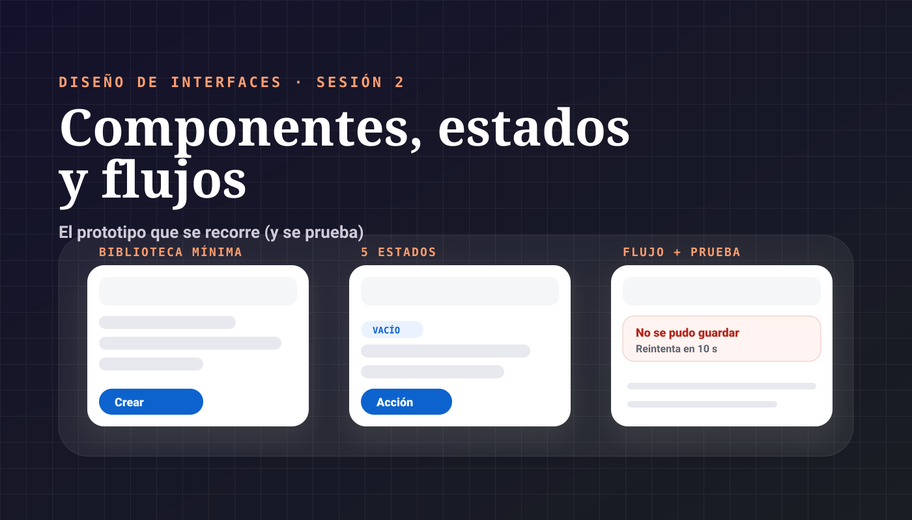

## Sesión 2 · Componentes, estados y flujos

**Martes 24 de noviembre, 9:15 – 10:45 p. m. (Lima).**

### Idea de la sesión

La pantalla bonita es la del caso feliz. La interfaz de verdad es la que sabe qué mostrar cuando no hay
datos, cuando tarda, cuando falla y cuando el usuario no puede. Esta sesión construye esa interfaz
completa y la pone en manos de tres personas antes de escribir una línea de código.

### Bloques (90 minutos)

1. **Anatomía de un componente (15 min) · Conceptos.** Variante, tamaño, estado (normal, hover, foco, activo, deshabilitado). Botón primario, secundario y peligroso; campo con etiqueta, ayuda y error.
2. **Biblioteca mínima (20 min) · Aplicación.** Seis componentes con los tokens de la sesión 1: botón, campo, selector, tabla, modal, aviso. Autolayout y propiedades en Figma.
3. **Los cinco estados (15 min) · Conceptos.** Vacío (con acción), cargando (esqueleto, no spinner), error (qué pasó y qué hacer), éxito (confirmación que no estorba), sin permiso.
4. **El flujo (20 min) · Aplicación.** Lista → detalle → formulario. Qué va en cada pantalla, qué se repite (encabezado, navegación) y cómo se vuelve atrás. Prototipo navegable.
5. **Copy UX y variantes con el agente (10 min) · Aplicación.** Textos de botones, mensajes de error en primera persona, títulos que son acciones. El agente propone tres; nosotros elegimos.
6. **Prueba de pasillo (10 min) · Experiencia.** Una tarea, un cronómetro, una persona del grupo. Dónde dudó.

### Herramientas

Figma (prototipo y variables) · aula LIVE con el agente JMD · cronómetro del teléfono.

## Tareas

- **Tarea 2 · Prototipo probado.** Enlace al prototipo navegable (tres pantallas, cinco estados) y la tabla de la prueba con tres personas: tiempo por tarea y primera duda.

## Materiales

- Brad Frost — *Atomic Design* (2016) (variante/sistema de componentes): https://atomicdesign.bradfrost.com/
- Scott Hurff — UI Stack (2015) (estados de UI): https://scotthurff.com/posts/how-to-fix-a-bad-user-interface-youre-ignoring-the-ui-stack/
- Luke Wroblewski — *Web Form Design* (2008) (fricción, formularios y prototipado): https://rosenfeldmedia.com/books/web-form-design/

## Agenda LIVE (escenas)

Carpeta: `lms/content/courses/diseno-interfaces/live/di-02/`

1. `01-bienvenida` · agenda + voto rápido
2. `00a-anatomia-componente` · teoría: variante × tamaño × estado
3. `02-biblioteca-minima` · biblioteca mínima (6 componentes + tokens)
4. `00b-cinco-estados` · teoría: cinco estados
5. `03-que-estado-falta` · juego + voto
6. `00c-prototipo-se-recorre` · teoría: flujo (ida y vuelta)
7. `04-prototipo-navegable` · checklist del prototipo navegable
8. `05-copy-con-el-agente` · sandbox + DeepSeek Harness
9. `06-prueba-de-pasillo` · prueba con cronómetro + muros
10. `07-cierre` · resumen + voto final

## Actividades

- Votos en vivo: `di02-molesta`, `di02-falta`, `di02-cierre`.
- Muros: `di02-pasillo-entendio`, `di02-pasillo-dudo`.

## Evaluación (qué se revisa)

**Aprobado** si la entrega tiene, como mínimo:

1. Prototipo navegable con **3 pantallas** conectadas (ida y vuelta).
2. En cada pantalla: **vacío, cargando, error, éxito y sin permiso** (5 estados).
3. Microcopy de error y permiso que diga **qué pasó + qué hacer**.
4. Tabla con **3 pruebas**: persona, tiempo y primera duda.

## Rutas (para profundizar)

- **Figma**: variantes y propiedades, auto layout y componentes.
- **Design tokens**: variables, escalas y consistencia (del sistema al UI).
- **Patrones de estados**: skeletons, empty states, permisos y mensajes de error.
